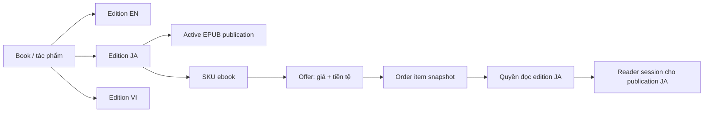

# Infinity Books Press — Product & architecture spec

Ngày: 2026-10-20. Trạng thái: đề xuất để review; chưa triển khai.

Website: **infinitybooks.press**. Thương hiệu: **Infinity Books Press**.

## 1. Mục tiêu và phạm vi

Chuyển fork này thành nền tảng độc lập để giới thiệu, chia sẻ và bán các bản ngôn ngữ của tác phẩm kinh điển thế giới. Hỗ trợ giao diện Việt, Anh, Nhật; một tác phẩm có nhiều bản dịch với EPUB, giá, tiền tệ và quyền đọc riêng.

Đây không phải đổi tên website production infinitybooks.vn. Không chuyển người dùng, đơn hàng, nội dung Phương Bùi hoặc thông tin nhận tiền từ website cũ sang mặc định. Mọi thay đổi triển khai chỉ áp dụng hạ tầng riêng của Press.

Trong đợt này: rebrand, homepage mới, JA, edition-aware catalog/admin/checkout/library/reader, localization mở rộng, bundle/gift/coupon tương thích, migration và kiểm thử. Chưa làm dịch tự động, marketplace cho dịch giả, subscription, đồng bộ vị trí đọc xuyên bản dịch, hay tự chuyển đổi ngoại tệ.

## 2. Kết quả kiểm tra codebase

Kết quả dưới đây từ source của fork tại commit `1470217`, không phải kiểm tra database production.

| Hiện trạng | Bằng chứng trong repo | Kết luận |
| --- | --- | --- |
| `books` có `original_language`, `active_publication_id`; `editions` có `language_code`, unique `(book_id, language_code, edition_number)` | `supabase/migrations/20260911090000_mvp_catalog_publishing.sql` | DB đã có nền tảng nhiều edition, nhưng một active publication ở cấp tác phẩm |
| SKU thuộc edition; offer thuộc SKU, có market/currency/price | Cùng migration trên | Tận dụng mô hình có sẵn; không tạo hệ sản phẩm song song |
| Admin DTO dùng `edition`, `sku`, `offer` dạng số ít; language/locale chỉ VI/EN | `lib/data/books.ts`, `lib/catalog/schemas.ts` | Luồng quản trị hiện hành chưa quản lý đầy đủ nhiều bản ngôn ngữ |
| Entitlements active và library unique theo `(profile_id, book_id)` | `supabase/migrations/20260911100000_mvp_access_admin.sql` | Quyền hiện tại áp dụng cho tác phẩm, chưa tách quyền từng ngôn ngữ |
| Library và reader lấy `books.active_publication_id` | `lib/data/library.ts`, `lib/reader/session.ts`, `lib/data/publications.ts` | Publish bản Nhật theo mô hình cũ có thể thay bản đang đọc của cả tác phẩm |
| Catalog/order chọn offer qua editions, dùng `limit 1`, checkout vào bằng book ID | `supabase/migrations/20261018100000_s19_book_sale_price.sql` | Phải chọn edition/offer tường minh, không dùng offer bất kỳ của tác phẩm |
| Metadata đã có bảng `*_localizations`; nhiều CHECK và RPC khóa VI/EN | Các migrations catalog, bundle, knowledge; `lib/i18n/config.ts` | JA cần thay đổi cả SQL, validation và UI, không chỉ thêm JSON |
| Bundle membership tham chiếu `book_id` | `supabase/migrations/20260924110000_s9_bundle_schema.sql` | Phải khóa chính xác edition được bán trong bundle |
| Locale switch dùng `otherLocale()` nhị phân | `lib/i18n/routes.ts` | Thay bằng bộ chọn N ngôn ngữ |
| Manual bank transfer đã có QR VND, khách báo chuyển khoản và admin xác nhận; repo còn có adapter SePay | `lib/commerce/manual.ts`, `lib/commerce/payment-provider.ts`, `docs/runbooks/manual-payment.md` | Press bật lại manual; không sử dụng SePay, kể cả VND |
| Homepage lấy tác giả của featured book, copy toàn site nói về Phương Bùi | `app/[lang]/(public)/page.tsx`, dictionaries | Không chỉ xóa tên: bỏ author band và thay định vị homepage |
| Logo tập trung qua component, ngoài ra có các icon/OG/email | `components/brand/logo.tsx`, `public/brand/infinity-logo.png`, `app/*icon*`, `supabase/templates/` | Cần audit đầy đủ điểm chạm thương hiệu |

**Trả lời câu hỏi “một sách chỉ có một ngôn ngữ?”:** không đúng hoàn toàn ở schema; đúng về giới hạn luồng sản phẩm hiện tại. Localized title/description không đồng nghĩa có EPUB bằng ngôn ngữ đó.

Tài liệu testing cũ còn mô tả “chưa production”, “chưa public catalog”; các đoạn đó không khớp source và thông tin người dùng. Khi triển khai phải cập nhật runbook, không coi những đoạn cũ là trạng thái production thực tế. `node_modules/next/dist/docs/` chưa có trong checkout này; bước triển khai phải cài dependencies theo lockfile rồi đọc guide local trước khi sửa Next.js.

## 3. Phương án kiến trúc

| Phương án | Ưu điểm | Hạn chế |
| --- | --- | --- |
| Một `book` riêng cho mỗi ngôn ngữ | Ít sửa checkout trước mắt | Trùng tác giả/series, khó nhóm tác phẩm, fallback và SEO rời rạc |
| **Một work (`books`), nhiều `editions`; quyền theo edition** | Phù hợp schema có sẵn; đúng đơn vị mua và đọc | Cần chuyển đồng bộ publication, commerce và access |
| Tạo hệ `works/translations/products` mới bên cạnh | Linh hoạt về lý thuyết | Migration lớn và trùng cấu trúc đang có |

Chọn phương án hai. Trong UI: “Tác phẩm” → “Bản ngôn ngữ”; trong code giữ tên `books`, `editions`, `skus`, `offers`.

## 4. Thương hiệu và homepage

- Tên hiển thị duy nhất: **Infinity Books Press**. Wordmark tạm là chữ thuần, accessible link về homepage; không tạo hoặc dùng lại biểu tượng infinity cũ.
- Xóa asset logo cũ; kiểm tra và thay/gỡ favicon, apple icon, icon dư, OG image, ảnh hero/portrait có thương hiệu hoặc hình Phương Bùi. Icon tạm trung tính nếu cần, không giả lập logo mới.
- Cập nhật header/footer/auth/admin shell, error/empty states, reader sharing, email giao dịch và Supabase Auth templates, SEO/JSON-LD/llms.txt, package name, cấu hình mẫu, fixture và tài liệu vận hành hiện hành. Centralize tên và origin trong `lib/config/brand.ts` mới.
- Không xóa tác giả kinh điển khỏi model. Chỉ bỏ author band hiện tại trên homepage và dữ liệu/copy đặc thù Phương Bùi khỏi nội dung Press. Không lấy mặc định ảnh/tác giả của featured book để giới thiệu nền tảng.
- Homepage: hero → tác phẩm nổi bật theo locale → giới thiệu nền tảng → khám phá tác giả/chủ đề → giải thích bản ngôn ngữ và cách đọc → CTA duyệt sách.
- Copy VI đề xuất: **“Tác phẩm kinh điển, đến gần hơn qua từng ngôn ngữ.”** Mô tả: “Infinity Books Press tuyển chọn những tác phẩm kinh điển thế giới, giới thiệu các bản dịch và giúp bạn đọc ngay trên trình duyệt. Khám phá tác phẩm, chọn ngôn ngữ và tìm bản đọc phù hợp.”
- Mỗi offer thể hiện miễn phí hoặc giá cụ thể; không quảng bá toàn bộ nền tảng là miễn phí.
- Không tự động mang theo tài khoản social, Shopee/Fahasa/Tiki, email hỗ trợ, ngân hàng hoặc analytics identity từ VN. Chỉ bật liên kết đã cấu hình cho Press.
- “Xóa toàn bộ thông tin” áp dụng vào runtime, asset và tài liệu đang dùng. Giữ migration đã áp dụng, lịch sử Git và tài liệu lịch sử có nhãn archive để không phá khả năng tái tạo/audit; không dùng chúng để seed nội dung cũ vào Press.

## 5. Ngôn ngữ: ba khái niệm độc lập

1. **UI locale**: `vi`, `en`, `ja` quyết định menu, thông báo, email và định dạng.
2. **Content language**: ngôn ngữ của EPUB/edition; không đổi khi người dùng chỉ đổi UI locale.
3. **Offer currency/market**: giá hợp lệ do admin cấu hình; không suy ra thị trường/ngân hàng từ locale hay IP.

### Registry và cấu hình

- Một registry ứng dụng trong `lib/i18n/config.ts`, gồm code, tên bản địa, Intl tag, direction, dictionary loader. Thay mọi `vi ? ... : en`, `otherLocale`, Record hai phần tử và enum phân tán.
- DB có `supported_locales(code, enabled)` để thay CHECK hardcode bằng FK; code là text chuẩn hóa, đủ mở rộng BCP 47. Migration đồng bộ các locale giao diện, test phát hiện lệch registry/DB. Ngôn ngữ gốc tác phẩm và ngôn ngữ nội dung dùng registry `content_languages` riêng để tác phẩm gốc tiếng Pháp không bị gắn giả thành EN/JA/VI.
- `platform_settings`: `default_ui_locale`, `default_content_language`, `default_metadata_locale`. Đề xuất ban đầu EN cho cả ba; admin được đổi trong tập hỗ trợ.
- `books.default_content_language` nullable, override mặc định nền tảng cho từng tác phẩm.
- `edition_pricing_defaults(language_code, market_code, currency, price_minor)` là mẫu nhập liệu do admin cấu hình. EN/USD, JA/JPY, VI/VND là gợi ý, không phải quy tắc cưỡng chế. Mặc định ban đầu không có giá trả phí; edition chưa có offer thì không mở bán.
- Thêm một UI locale mới cần dictionary, registry entry, migration seed, bản dịch nội dung và QA. Không hứa admin có thể bật một UI locale chưa có bản dịch code bằng một click.
- Admin tiếp tục ở `/admin`, có thể giữ UI English; các form localization phải thêm tab JA và sinh tab từ registry. Customer routes vẫn `/{locale}`.
- Dịch đủ giao diện public/auth/account/library/checkout/reader, validation/error/empty states, email, chia sẻ, SEO. Auth mail chọn locale từ allowlist do server xác nhận; không nội suy HTML hoặc locale tùy ý từ metadata người dùng.

### Localized metadata

Books, authors, series, topics, bundles, ideas, articles đều hỗ trợ JA trong bảng hiện hữu. Bao gồm slug, title/name, description/body, FAQ/key ideas, SEO, alt text/caption và các trường dịch được khác. Không nhân bản entity chỉ để thêm locale.

Metadata fallback: requested UI locale → platform default metadata locale → bản metadata gốc bắt buộc của entity. Lấy cả bản localization, không trộn title tiếng Nhật và body tiếng Việt theo từng field. Trả về `metadataLocale`, hiển thị nhãn nội dung đang dùng ngôn ngữ khác khi cần. Article/idea chỉ fallback sang bản đã published, không lộ draft.

## 6. Edition, publishing và dữ liệu

- `editions` thêm `status`, `active_publication_id`; pointer phải trỏ publication có asset thuộc đúng edition. `books.active_publication_id` chỉ còn tạm để migration, sau cutover bỏ đọc/ghi và cuối cùng xóa bằng migration riêng.
- Một edition là một bản dịch có quyền đọc ổn định. EPUB revision, sửa lỗi hoặc rollback vẫn thuộc cùng edition; không làm khách mua lại. `edition_number` cho bản dịch/ấn bản độc lập. MVP chỉ có một edition được bán mặc định cho mỗi `(book_id, language_code)`; admin có thể giữ edition cũ cho người đã mua nhưng không đưa ra chọn mua mới.
- Không suy ra edition mặc định bằng `limit 1`. Dùng bảng `book_language_editions(book_id, language_code, edition_id)` với unique `(book_id, language_code)` và kiểm tra edition thuộc đúng book/language.
- Cover riêng ở edition, fallback cover chung của work. Thông tin contributor, dịch giả, lời giới thiệu bản dịch, ngôn ngữ và source đặt ở edition; tên/tóm tắt tác phẩm dùng book localizations.
- Admin tạo work → thêm edition EN/JA/VI → upload/process/preview → cấu hình offer → publish từng edition. Publish/rollback JA không ảnh hưởng EN/VI. Global archive work vẫn ẩn khỏi discovery; chính sách truy cập người đã mua phải được kiểm thử và giữ nhất quán với trạng thái thu hồi.
- Không cho đổi language/book của edition đã có order hoặc entitlement; tạo edition mới nếu nhập sai sau khi bán.
- Publish readiness kiểm tra EPUB thuộc edition, ngôn ngữ EPUB khớp khai báo, metadata tối thiểu, lựa chọn edition mặc định không mơ hồ. Offer thiếu hoặc hết hiệu lực không được mua, nhưng edition đã có người sở hữu vẫn đọc được khi publication hợp lệ.
- RLS và RPC: `requireAdmin()` trước thao tác quản trị; service role chỉ sau gate nếu thật sự cần. SQL RPC tự kiểm tra quyền, không tin gate UI.

## 7. Quy tắc catalog và fallback

Áp dụng thống nhất cho homepage, catalog, search, recommendation, trang tác giả/series/topic và book detail.

1. Chọn edition published được cấu hình cho UI locale.
2. Nếu không có, thử **một** ngôn ngữ mặc định hiệu lực: book override hoặc platform default.
3. Nếu vẫn không có edition đọc được, không hiển thị work ở listing; detail trả unavailable/404 phù hợp. Không tự chọn ngôn ngữ thứ ba theo thứ tự DB.
4. Một work chỉ xuất hiện một card; card luôn ghi ngôn ngữ EPUB thực tế, giá và currency của offer thuộc edition đã chọn.
5. Có edition JA nhưng không có offer mua được: hiển thị JA với trạng thái chưa mở bán; không tự chuyển sang EN vì EN rẻ hơn hoặc còn offer.
6. Metadata không có JA không có nghĩa EPUB JA không có: fallback metadata và fallback edition là hai phép chọn độc lập.

Ví dụ: UI JA, work có EN và VI, default EN → thấy “Bản tiếng Anh”, giá EN; mua chỉ được EN. Khi JA được publish, listing JA tự chuyển sang JA; đơn EN đã tạo vẫn là EN, không đổi sản phẩm hoặc giá.

Book detail có bộ chọn bản ngôn ngữ, không đổi UI locale khi chọn edition. Route `/{locale}/books/{slug}?edition={editionId}` cho lựa chọn rõ ràng; kiểm tra edition thuộc work và visible. Khi tham số edition không hợp lệ trả unavailable/404, không âm thầm mua default. Href lang switch giữ work ID rồi resolve slug ở locale đích; không thay prefix của một slug dịch khác.

Giá lấy từ default offer do admin chọn cho edition trong MVP; không tự chọn rẻ nhất và không tự đổi tiền. Tương lai có market selector sẽ là quyết định riêng. Cache key chứa UI locale, edition và offer context; sửa default/publish/offer/localization invalidates mọi locale liên quan.

Library là ngoại lệ có chủ ý: luôn hiện tất cả edition khách sở hữu, nhóm theo work và gắn badge EN/JA/VI; đổi UI không làm biến mất sách đã mua. Bộ lọc ngôn ngữ chỉ là tùy chọn. Không chạy catalog fallback để chọn thứ khách sẽ đọc.

## 8. Giá, đơn hàng và quyền đọc

- Order tạo bằng `edition_id` và `offer_id`, server xác thực quan hệ SKU/edition/work, publication, cửa sổ offer và quyền đã có. Không nhận số tiền/currency từ client làm nguồn tin cậy.
- Đơn lưu snapshot book/edition/language/title/SKU/offer, giá gốc, giảm giá, giá phải trả, currency và provider. Đổi locale, defaults, bản dịch hoặc giá sau đó không sửa snapshot.
- Giá lưu integer minor units; currency metadata quy định exponent. Test 500 JPY = ¥500; 500 USD minor = $5.00; 50000 VND minor = 50.000 ₫. Không chia mặc định mọi currency cho 100; tránh mất chính xác khi đưa bigint sang JS.
- Một order chỉ có một currency. Bundle có một giá/currency riêng, không cộng các giá khác currency. Không có conversion ngầm.
- Default pricing chỉ prefill khi tạo offer mới; thay default không cập nhật hàng loạt offer cũ. Đổi giá hiện có là thao tác explicit và có audit.
- **Quyết định đã chốt: Press dùng `manual` bank transfer, không sử dụng SePay kể cả VND.** Tận dụng luồng hiện hữu: tạo đơn → hiển thị QR tài khoản và thông tin chuyển khoản → khách bấm “Đã chuyển khoản” → admin đối chiếu sao kê tại `/admin/payments` → xác nhận hoặc từ chối. Chỉ xác nhận hợp lệ của admin mới cấp quyền; thao tác báo chuyển khoản của khách không cấp quyền.
- Bật đồng bộ `PAYMENT_PROVIDER=manual` ở app và `commerce_settings.payment_provider='manual'` ở DB; chỉ bật `payments_enabled=true` sau khi thông tin tài khoản Press và smoke test đã đúng. Cấu hình đủ `BANK_TRANSFER_BANK_CODE`, `BANK_TRANSFER_BANK_NAME`, `BANK_TRANSFER_ACCOUNT_NUMBER`, `BANK_TRANSFER_ACCOUNT_HOLDER`. Không dùng lại tài khoản VN mặc định.
- QR VND lấy đúng tài khoản, số tiền và mã đơn từ snapshot; luôn hiển thị thông tin dạng text để khách chuyển khoản khi QR không tải/quét được. Admin ghi số tiền thực nhận và mã giao dịch ngân hàng; giữ kiểm tra thiếu/thừa tiền, quyền admin, audit và idempotency hiện có. Đơn đã báo chuyển khoản không bị đổi giá theo offer mới.
- Không cấu hình SePay credentials, không redirect checkout sang SePay và không nhận SePay callback để cấp quyền trên Press. Adapter/migration lịch sử có thể giữ để tránh sửa lịch sử, nhưng không là lựa chọn runtime Press; simulator chỉ dùng local/test/staging.
- Thanh toán manual QR ở launch dùng VND cho mọi bản EN/JA/VI. Schema vẫn hỗ trợ giá/currency riêng theo edition; paid USD/JPY chưa mở checkout cho đến khi có tài khoản nhận đúng currency và quy trình manual được cấu hình, kiểm thử. Không tự quy đổi USD/JPY thành VND hoặc tạo VietQR giả cho ngoại tệ. Mở rộng manual đa tiền tệ là workstream riêng; không mặc định tích hợp cổng thanh toán tự động.
- Free offer vẫn tạo acquisition audit và grant đúng edition; không cần provider trả phí.
- Chuyển entitlements và library uniqueness sang `(profile_id, edition_id)`. Giữ `book_id` khi cần query/compatibility nhưng kiểm tra khớp edition.
- Free claim, admin grant/revoke, paid order, manual confirmation, gift và bundle đều phải đi qua cùng edition-aware grant boundary. Admin xác nhận lặp không tạo quyền mới; revoke một nguồn không vô tình xóa quyền từ nguồn còn hiệu lực.
- Khóa/idempotency order theo profile + edition + intent thích hợp; mua EN không chặn mua JA. Không tạo hai đơn active tương đương do double click. Giá đổi có thông báo yêu cầu tạo lại đơn theo cơ chế hiện hành, không âm thầm đổi tiền.

## 9. Bundle, gift và tính năng liên quan

- Bundle chứa **edition cố định**, không chứa work rồi resolve tại lúc trả tiền. Đổi membership sang `(bundle_id, edition_id)`; có thể bán bundle EN+JA nếu mô tả rõ.
- Một bundle là một sản phẩm riêng, có localized metadata VI/EN/JA. Bundle “Classic EN” và “Classic JA” là hai bundle nếu nội dung được cấp khác nhau; không đổi contents theo UI locale.
- Bộ lọc discovery: bundle đơn ngôn ngữ khớp locale trước, fallback default nếu không có bản phù hợp; bundle hỗn hợp có nhãn từng ngôn ngữ, hiển thị như bundle hỗn hợp. Không ghi “bản Nhật” nếu trong đó có EN.
- Order snapshot toàn bộ edition IDs trong bundle; sửa bundle sau checkout không đổi quyền đơn cũ. Không tự cấp thêm edition được thêm vào bundle sau này.
- Gift giữ nguyên edition snapshot từ lúc mua tới lúc nhận, kể cả người nhận dùng locale khác.
- Coupon work-level chỉ áp dụng cho các edition thuộc work đó theo rule đã định; edition-level là scope mới nếu cần. Fixed-amount coupon phải trùng currency của order; percentage coupon làm tròn theo minor unit và không vượt giá trị đơn.
- Reviews gắn edition để người đọc biết đang đánh giá bản dịch nào; aggregate work là view có breakdown. Reviews cũ backfill edition như quyền đọc. Shared quotes/annotations vẫn gắn publication, không được resolve sang bản ngôn ngữ khác.
- Ask-the-author không phù hợp làm CTA mặc định cho tác giả kinh điển. Tắt ở nội dung mới trừ khi admin bật; đề xuất đổi luồng thành “Gửi góp ý bản dịch” tới ban biên tập, không giả là tác giả quá cố trả lời.

## 10. Reader, tìm kiếm, SEO và khả năng mở rộng

- Route đọc chuẩn: `/{locale}/read/editions/{editionId}`. Session/resource/progress RPC xác thực entitlement của edition sở hữu publication được yêu cầu. Có EN không đọc được JA qua URL, session hoặc resource endpoint trực tiếp.
- Progress, bookmarks, annotations, completion giữ scope publication/edition. Không copy locator giữa bản dịch; update EPUB giữ chính sách phiên bản hiện hành và hiển thị rõ khi không thể restore vị trí.
- Deep link cũ `/read/{bookId}` chỉ resolve trong các edition người dùng đã sở hữu: một edition thì redirect; nhiều edition thì mở bộ chọn; không có thì denied. Không chọn dựa trên UI locale để vô tình đổi cuốn đang đọc.
- Giữ `ReaderEngine` và EPUB sanitization/private storage boundary. JA QA với kana/kanji, ruby/furigana, dấu câu, font fallback, line break, TOC, search, selection, quote limits. Vertical writing chỉ cam kết sau khi fixture và trình duyệt đạt kiểm thử; MVP có thể chuẩn hóa bản JA sang horizontal layout có khai báo.
- Search lấy text metadata có fallback, chọn edition bằng cùng resolver; thêm regression tìm chữ Nhật không có khoảng trắng. MVP có thể dùng Unicode substring/trigram phù hợp; không giả định tokenizer tiếng Anh xử lý được JA.
- Metadata canonical dựa work + UI locale; query chọn edition không tạo vô số trang index. JSON-LD/giá trên trang phải mô tả edition đang hiển thị. Hreflang chỉ liệt kê bản metadata thực sự có và published; trang fallback toàn bài sang ngôn ngữ khác dùng canonical về bản nguồn, không nhận là bản dịch JA.
- Sitemap/static params và `llms.txt` lấy locales từ registry, không tạo đường dẫn của draft hoặc locale thiếu nội dung hợp lệ. Cập nhật prerender checks và revalidation cho ba locales.

## 11. Đề xuất bổ sung theo ưu tiên

**P0 — nên có trước launch nội dung:** hồ sơ nguồn và quyền phát hành ở work/edition: nguồn văn bản gốc, tác giả, người dịch, nguồn bản dịch, ghi chú quyền sử dụng, phạm vi lãnh thổ dự kiến, người duyệt, ngày duyệt. Workflow `unreviewed → approved/blocked`; không publish edition chưa được duyệt. Đây là yêu cầu lưu bằng chứng và duyệt nội dung, không phải kết luận pháp lý rằng mọi bản dịch của tác phẩm cũ đều được tự do sử dụng.

**P0:** credits dịch giả/biên tập, nhãn ngôn ngữ nổi bật trước mua, sample đúng edition, gửi góp ý lỗi dịch có publication/locator. MVP góp ý chỉ là form gửi ban biên tập, chưa cần cộng đồng chỉnh sửa.

**P1:** thông báo khi bản ngôn ngữ mong muốn ra mắt; trang ngôn ngữ và dịch giả; lọc sách miễn phí; changelog bản dịch; quản lý hàng đợi bản dịch theo chất lượng.

**P2:** đọc song song hai ngôn ngữ sau khi có mô hình alignment và quyền hai edition; collaborative translation; audio. Không đưa vào migration nền tảng lần này.

## 12. Migration và launch độc lập

1. Tạo cấu hình triển khai Press riêng: Supabase, storage, auth callback, domain, email sender, analytics và tài khoản nhận chuyển khoản. Không reuse cloud project VN. Không clone PII/orders/keys hoặc EPUB Phương Bùi.
2. Inventory code/schema trên local; kiểm tra toàn bộ CHECK/RPC `vi/en`, book-level entitlement/publication và các SELECT first edition. Dùng migration mới; không sửa migration lịch sử.
3. Expand schema trước: locale registry/settings, edition publication/default mapping, edition ID nullable ở các bảng cần chuyển. Backfill theo asset/sku/publication có bằng chứng. Nếu legacy row mơ hồ thì xuất report và chặn cutover; không cấp tất cả bản dịch để “giữ tương thích”.
4. Với Press DB sạch vẫn kiểm thử upgrade fixture single-edition để phát hiện dependency bị bỏ sót. Tạo catalog seed trung tính, không sao chép nội dung thương mại của VN.
5. Chuyển read/write đồng bộ qua release có maintenance window trên Press; tạm dừng checkout/worker khi backfill. Order pending phải được drain/cancel có kiểm soát hoặc map snapshot edition chính xác trước khi mở checkout và admin confirmation trở lại. Không sửa snapshot đơn paid.
6. Backfill assertions: mỗi entitlement/library/order item ánh xạ đúng một edition; publication pointer thuộc edition; progress/annotations còn trỏ đúng publication; gift/bundle snapshot bảo toàn; không tăng quyền sang ngôn ngữ mới.
7. Bật NOT NULL/FK/unique và edition-only RPC; đóng đường ghi book-only. Cập nhật generated database types. Chỉ xóa cột compatibility ở release sau khi không còn caller cũ.
8. Rollback: trước cutover có thể rollback app; sau khi có order/entitlement đa edition không chạy lại app book-only. Dùng maintenance + forward fix hoặc restore backup theo điểm đã duyệt, có đối soát sự kiện thanh toán sau backup. Không dùng `db reset` trên cloud.

## 13. Acceptance criteria

| ID | Kịch bản bắt buộc | Kết quả |
| --- | --- | --- |
| A01 | Crawl UI/email/OG/assets hiện hành | Không còn logo/tên cũ đứng riêng, Phương Bùi hoặc liên kết VN; tên Press đầy đủ |
| A02 | Mở VI/EN/JA, đổi locale tại detail/auth/account | Đúng copy, đúng entity; không mất next/return URL hoặc authorization |
| A03 | Một work có EN/JA/VI | Một card theo locale; selector chọn đúng EPUB/offer |
| A04 | UI JA nhưng chỉ có EN/VI, default EN | Badge EN, giá EN, mua EN; không có JA thì không giả là bản JA |
| A05 | Default thiếu publication; hoặc JA có EPUB nhưng thiếu offer | Không random fallback; không mua edition khác âm thầm |
| A06 | Mua EN rồi thử đọc JA bằng URL/RPC/resource | Bị từ chối; mua JA riêng thì đọc được JA |
| A07 | Publish/rollback JA | EN và progress EN không đổi |
| A08 | Đổi UI sau mua EN+JA | Library giữ cả hai, progress độc lập |
| A09 | Đổi giá/default/bundle sau tạo order/gift | Snapshot giữ đúng edition và currency; checkout stale xử lý rõ ràng |
| A10 | Double click/admin confirm lặp/refund/revoke | Không grant dư hoặc revoke sai edition/nguồn |
| A11 | VND/JPY/USD và coupon sai currency | Hiển thị minor units đúng; provider unsupported bị chặn server-side |
| A12 | Metadata JA cho bundle/author/series/topic/idea/article | CRUD/readiness/search/SEO xử lý đúng; draft không fallback ra public |
| A13 | EPUB Nhật với ruby/kanji/search/quote | Đọc/restore/search được trong profile hỗ trợ, sanitization không bị nới |
| A14 | Upgrade fixture có dữ liệu cũ và dữ liệu mơ hồ | Có mapping kiểm chứng; row mơ hồ chặn migration/cutover |
| A15 | Thay platform default, publish hoặc sửa metadata | Cache mọi locale liên quan cập nhật; sitemap/hreflang không sai |
| A16 | Manual QR: báo chuyển khoản, admin confirm/decline, SePay callback | Báo chuyển khoản không cấp quyền; confirm đúng mới cấp edition; callback SePay không cấp quyền |

## 14. Giả định dùng để lập plan

- Press launch bằng database riêng và catalog mới; không có nhiệm vụ migrate khách hàng VN.
- UI mặc định EN; fallback nội dung EN, cho phép admin override từng work.
- Miễn phí và trả phí cùng được hỗ trợ; mỗi bản ngôn ngữ là quyền riêng.
- Đã chốt theo yêu cầu người dùng: bật lại manual QR + admin confirm, tuyệt đối không SePay. Launch paid VND; nhận USD/JPY sau khi hoàn tất workstream manual đa tiền tệ.
- Admin UI giữ English, customer UI có VI/EN/JA.
- Bundle có contents edition cố định; library luôn hiện mọi bản đã sở hữu.

Ngoài quyết định manual QR + admin confirm và không SePay đã được người dùng xác nhận, các mặc định còn lại là đề xuất để review.
